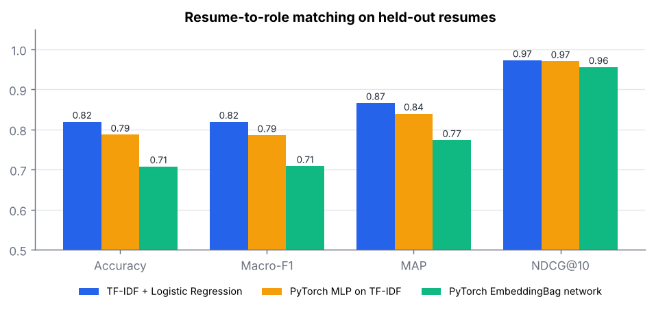
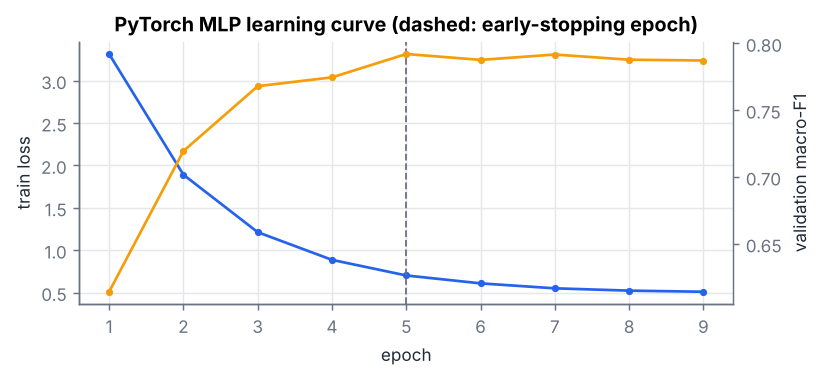
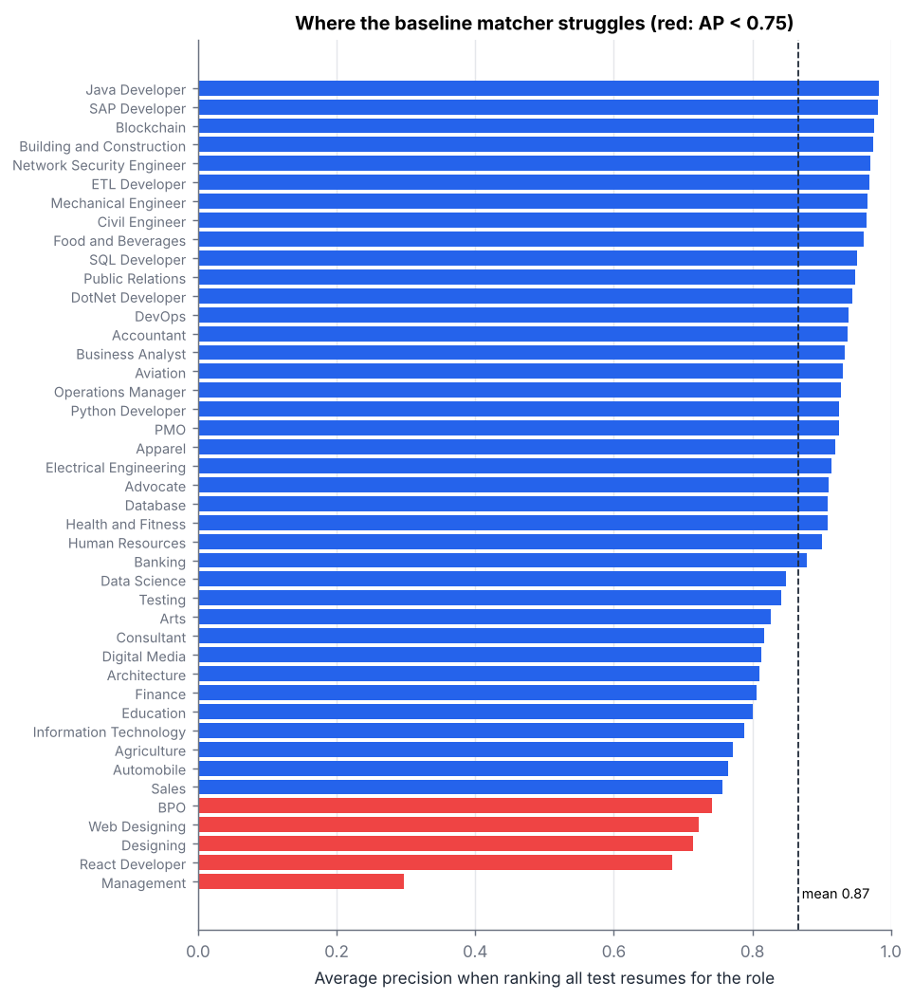
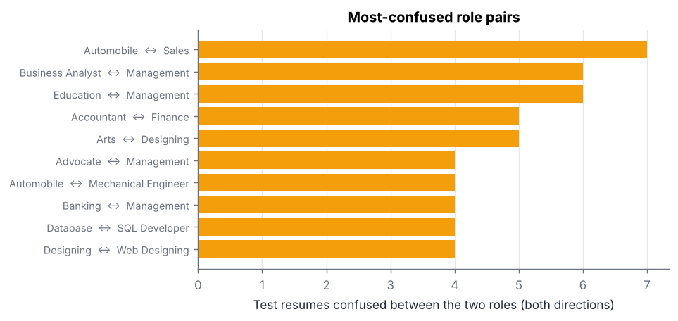
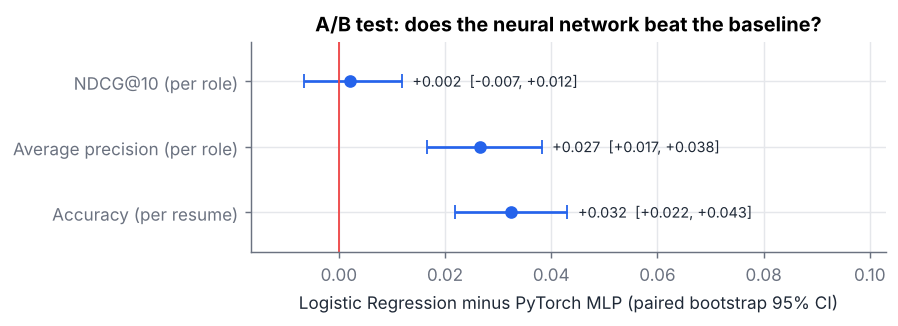
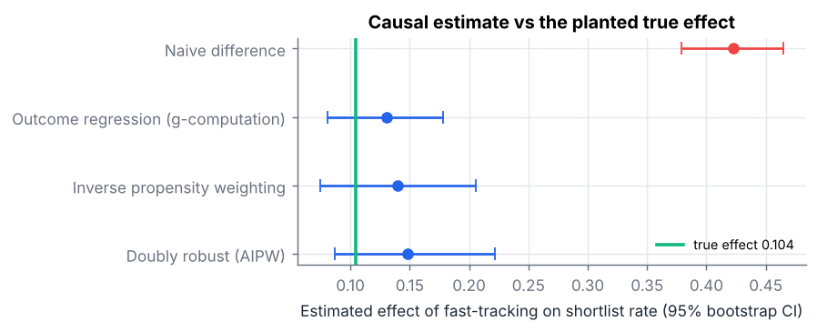

# Hiring Signal Lab

Data science on real resumes: matching candidates to roles, testing whether one model is genuinely better than another, and estimating cause and effect in a hiring funnel.

Built with Python, Pandas, NumPy, SciPy, Scikit-learn, PyTorch and Matplotlib on **11,922 real resumes across 43 job roles**.

The project asks three questions a recruiting platform has to answer before trusting its own numbers:

1. **Matching:** how well can a model rank the right resumes for a role, and *why* does it fail where it fails?
2. **A/B testing:** when a new model scores a little higher, is it actually better, or is that noise?
3. **Causal inference:** when fast-tracked candidates get shortlisted more often, how much of that is the fast-track, and how much is that they were stronger to begin with?

## Headline results

| Question | Finding |
|---|---|
| Matching | Logistic regression on TF-IDF ranks resumes for 43 roles at **NDCG@10 0.973** and **MAP 0.866**, with 81.9% top-1 accuracy. |
| Title leakage | Removing every job-title word from the resumes drops accuracy from 81.9% to **74.3%**. About 8 points of accuracy come from candidates stating their own title, not from their experience. |
| Model A/B test | The simpler logistic regression beats a PyTorch MLP by **+3.2 points** of accuracy (95% CI +2.2 to +4.3, McNemar p = 7e-10) and on average precision in 41 of 43 roles. **But at the top 10 the two are indistinguishable** (NDCG@10 difference +0.002, CI −0.007 to +0.012, Wilcoxon p = 0.92). |
| Causal | Fast-tracked candidates are shortlisted **42 points** more often, but the planted true effect is **10.4 points**. Confounding inflates the naive estimate about 4x. Adjusted estimators recover the truth with under 0.2 points of bias across 300 simulations, and AIPW's 95% intervals cover it **94.3%** of the time. |

## Data

[Resume Classification Dataset](https://github.com/noran-mohamed/Resume-Classification-Dataset) (MIT licence): 13,389 resumes extracted by OCR from LiveCareer, Google Images and Bing Images, each labelled with one of 43 job titles.

Two cleaning steps matter more than any model choice:

| Step | Rows |
|---|---|
| Raw | 13,389 |
| Fewer than 30 words (OCR failures) | −12 |
| Duplicates, including 169 texts that appear under *two different labels* | −1,455 |
| **Kept** | **11,922** |

Duplicates are removed **before** splitting. Otherwise one copy can land in training and another in test, and the model is graded on text it has already memorised. Texts with conflicting labels are dropped entirely because there is no right answer to learn from them.

Split: stratified 70 / 15 / 15 (8,345 train, 1,788 validation, 1,789 test). Every number below is on the untouched test set.

## 1. Matching resumes to roles

Each resume gets a fit score for every role. For each role, all 1,789 test resumes are ranked by that score, and the ranking is graded by whether the role's true candidates come out on top. Ranking metrics are averaged over the 43 roles.

| Model | Accuracy | Macro-F1 | Top-3 acc. | MAP | NDCG@10 | P@10 |
|---|---|---|---|---|---|---|
| **TF-IDF + Logistic Regression** | **0.819** | **0.819** | **0.924** | **0.866** | **0.973** | **0.960** |
| PyTorch MLP on TF-IDF | 0.787 | 0.786 | 0.903 | 0.840 | 0.970 | 0.956 |
| PyTorch EmbeddingBag (fastText-style) | 0.708 | 0.709 | 0.842 | 0.773 | 0.956 | 0.940 |



The two PyTorch models are trained with class-weighted cross-entropy and early stopping on validation macro-F1. The MLP uses exactly the same TF-IDF features as the logistic regression, so any gap comes from the model, not the text representation. Both networks overfit quickly on 8,345 documents: the MLP peaks at epoch 5 and the EmbeddingBag model's training loss falls almost to zero while validation F1 stalls at 0.70.



### Where the matcher fails, and why



**Management is the outlier (AP 0.30).** Almost every senior resume mentions managing something, so "Management" has no vocabulary of its own. It is the role most often confused with Business Analyst, Education, Advocate and Banking. The other weak roles are near-synonyms (Designing vs Web Designing vs Arts) or simply rare: React Developer has only 182 resumes in the raw data and 16 in the test set.



**Product implication:** these are not model bugs to tune away. "Management" and "Designing" are ambiguous as *labels*. A matching product should either score them against a more specific job description, or show recruiters the second-best role, since top-3 accuracy is 92.4% against 81.9% for top-1.

### Title-leakage ablation

Many resumes literally state their job title. To measure how much the model relies on that shortcut, every word appearing in any of the 43 role names is removed and the baseline is retrained:

| | Accuracy | MAP | NDCG@10 |
|---|---|---|---|
| Full text | 0.819 | 0.866 | 0.973 |
| All role-name words removed | 0.743 | 0.790 | 0.955 |

The model still gets 74% right from skills and experience alone, but about 8 points of its accuracy are the candidate's self-declared title. For a matching product that is a risk: a candidate who writes the right title gets ranked up whether or not their experience supports it.

## 2. A/B test: is the neural network better?

Both models score the same 1,789 resumes, so the comparison is **paired**, testing the per-resume difference rather than two independent averages. That removes between-resume noise and gives a much sharper test.



| Metric | LogReg − MLP | 95% CI (paired bootstrap) | Test |
|---|---|---|---|
| Accuracy (per resume) | +0.032 | +0.022 to +0.043 | McNemar exact: 75 vs 17 discordant, p = 7.3e-10 |
| Average precision (per role) | +0.027 | +0.017 to +0.038 | LogReg better in 41 of 43 roles, Wilcoxon p = 2.6e-8 |
| NDCG@10 (per role) | +0.002 | −0.007 to +0.012 | Wilcoxon p = 0.92 (no difference) |

**Reading it correctly:** the logistic regression is genuinely better overall, but only deeper in the ranking. On the top 10 candidates, which is what a recruiter actually looks at, the two models cannot be told apart. Which metric decides the launch depends on how the product is used, and the test makes that trade-off visible instead of hiding it in one average.

**Power:** the two models disagree on 5.1% of resumes. At that rate, detecting a 2-point accuracy difference with 80% power needs about 1,007 test resumes (this test set has 1,789), but detecting a 1-point difference would need about 4,034. Smaller model improvements than that should not be claimed from this test set.

## 3. Causal inference: does fast-tracking work?

**Question:** a recruiter can fast-track a candidate. Fast-tracked candidates are shortlisted far more often. How much of that is caused by the fast-track?

Real recruiting logs never reveal the true answer, so no estimator can be checked on them. Instead, this builds a **semi-synthetic funnel** on the 1,789 real test resumes with a known effect planted in it:

- covariates come from the real data: the matcher's out-of-sample fit score for the candidate's role, and resume length (an experience proxy);
- stronger candidates are more likely to be fast-tracked (**confounding**), and also more likely to be shortlisted anyway;
- fast-tracking adds a fixed boost on the log-odds scale. Both potential outcomes are simulated, so the true average treatment effect is known exactly: **+10.4 points**.



| Estimator | Estimate | 95% bootstrap CI | Bias over 300 simulations | RMSE |
|---|---|---|---|---|
| Naive difference (treated − untreated) | 0.423 | 0.379 to 0.464 | +0.308 | 0.308 |
| Outcome regression (g-computation) | 0.131 | 0.081 to 0.178 | −0.002 | 0.024 |
| Inverse propensity weighting | 0.140 | 0.075 to 0.206 | −0.001 | 0.031 |
| Doubly robust (AIPW) | 0.149 | 0.087 to 0.222 | −0.002 | 0.028 |

- The **naive comparison is about 4x too high**, purely because stronger candidates are both fast-tracked and shortlisted more.
- All three adjusted estimators include the true effect in their intervals on this sample and are essentially unbiased across 300 repeated studies.
- **Covariate balance:** the standardised mean difference in fit score between fast-tracked and other candidates is 1.33 before weighting and 0.03 after inverse-propensity weighting, well under the usual 0.1 bar.
- **Calibration:** AIPW's 95% confidence intervals contain the true effect in **94.3%** of 300 simulations, so the intervals mean what they say.
- **Robustness:** with a non-linear outcome the linear models cannot fit, all three adjusted estimators still stay within 0.2 points of the truth on average (AIPW coverage 96.7%).

**Limitation:** the funnel is simulated. This validates the *estimators* on realistic covariates; it is not a claim about real fast-track programmes. On real data the main risk is an unmeasured confounder (for example, a recruiter's private impression of the candidate), which no method here can correct.

## Run it

```bash
pip install -r requirements.txt
python fetch_data.py      # downloads the dataset (65 MB) into data/raw/
python run.py             # full pipeline, about 10 minutes on a laptop CPU
python run.py --quick     # 2-epoch smoke test
pytest                    # 10 unit tests
```

Outputs: `reports/metrics.json`, `reports/per_role_baseline.csv`, `reports/figures/*.png`. Results above are from seed 42; PyTorch on a different CPU can shift the neural models' numbers slightly.

## Project structure

```
hsl/data.py          loading, normalisation, de-duplication, stratified split, title masking
hsl/models.py        TF-IDF logistic regression, PyTorch MLP, PyTorch EmbeddingBag network
hsl/metrics.py       NDCG@k, MAP, MRR, P@k, accuracy, macro-F1
hsl/experiments.py   paired bootstrap, McNemar, Wilcoxon, McNemar sample-size (power)
hsl/causal.py        semi-synthetic funnel, g-computation, IPW, AIPW, covariate balance
run.py               end-to-end pipeline and charts
tests/               pytest unit tests for metrics, statistics and estimators
```

## Next steps

- Score resumes against real **job descriptions** rather than role labels, with sentence embeddings, and re-run the same A/B framework.
- Calibrate the matcher's probabilities so a "0.8 fit" means the same thing across roles.
- Audit the matcher for bias across groups once demographic fields are available, using the same paired-test machinery.
